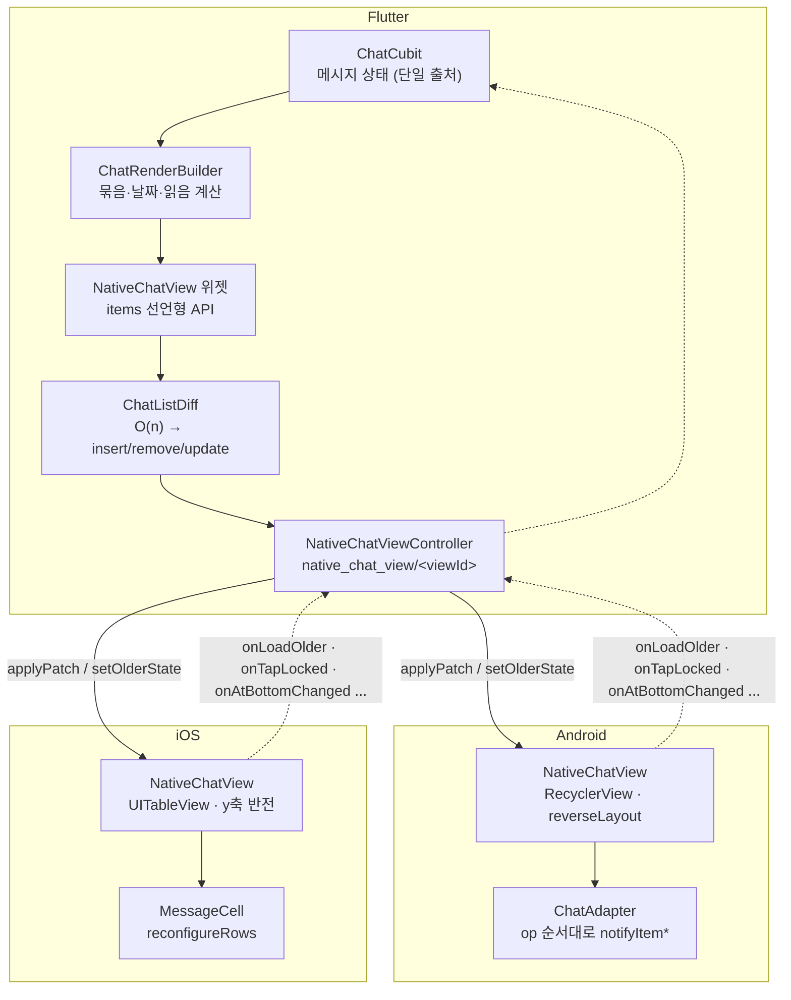
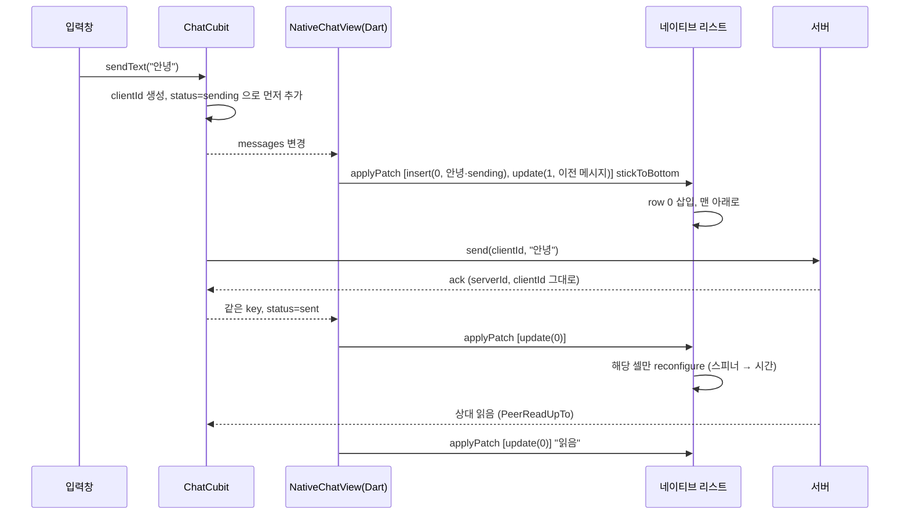

# Flutter Native Chat View

Flutter 채팅 화면에서 **메시지 목록만** 네이티브 리스트로 그리는 구조입니다.
입력창·화면 전환·상태 관리는 Flutter 에 두고, 길고 무거운 스크롤 목록은 플랫폼 리스트가 맡습니다.

- **Android**: `RecyclerView` (reverseLayout) — `AndroidView`
- **iOS**: `UITableView` (y축 반전) — `UiKitView`
- **Flutter**: Clean Architecture, Cubit, 목록 diff 를 계산해 변경분만 네이티브로 전송

> 데이팅 1:1 채팅 앱(회원 약 1.2만 명)에서 클라이언트를 혼자 맡아 구현했던 채팅 목록 구조를,
> 회사 코드·서버 없이 다시 정리한 저장소입니다. 가짜 서버(`FakeChatRepository`)가 들어 있어 **키나 서버 없이 바로 실행**됩니다.

---

## 왜 목록을 네이티브로 옮겼나

실서비스에서 Flutter `ListView` 로 만든 채팅 목록이 스크롤 중에 깜빡이는 문제가 있었고, 목록을 네이티브 PlatformView 로 옮겨 해결했습니다.
채팅 목록은 일반 목록과 요구사항이 다릅니다.

- 최신 메시지가 **아래**에 있고, 과거 메시지를 **위로** 계속 불러온다 → 불러온 뒤에도 보던 위치가 그대로여야 한다
- 텍스트·사진·선물 카드처럼 **높이가 제각각인 셀**이 수천 개까지 쌓인다
- 새 메시지가 오면 맨 아래를 보고 있을 때만 따라 내려가야 한다

이 동작들은 `RecyclerView` / `UITableView` 가 오래 다듬어 온 영역이라, 목록만 네이티브로 두고 나머지는 Flutter 에 남겼습니다.

**대가도 있습니다.** PlatformView 는 Flutter 위젯보다 합성 비용이 크고, 목록 위에 Flutter 위젯을 겹치는 데 제약이 있으며,
같은 UI 를 Kotlin·Swift 두 번 만들어야 합니다. 그래서 네이티브 쪽은 "그리기만" 하도록 최대한 얇게 만들었습니다 (아래 1번).

---

## 핵심 설계

### 1. 판단은 Dart 에서 한 번, 네이티브는 그리기만

날짜 구분선, 프로필 생략, 시간 생략, 읽음 표시 같은 **묶음 규칙**을 `ChatRenderBuilder`(Dart)에서 계산해
"그릴 준비가 끝난" `ChatRenderItem` 으로 넘깁니다. Kotlin·Swift 셀은 받은 값을 그대로 그립니다.

실서비스 버전은 같은 묶음 규칙(`ChatUtil`)이 Dart·Kotlin·Swift 세 곳에 있었습니다. 규칙을 하나 바꾸려면 세 언어를 같이 고쳐야 했습니다.

### 2. 변경분만 보낸다 — 순서 보존 O(n) diff

`NativeChatView` 위젯은 `ListView` 처럼 `items` 만 받습니다. 이전에 보낸 목록과 비교해 `insert / remove / update` op 만 채널로 보냅니다.

```
새 메시지 하나 도착
  → ops: [insert(0, [m3]), update(1, m2)]     // m2 는 같은 묶음이 되면서 시간 표시가 사라짐
이전 메시지 30개 불러옴
  → ops: [insert(120, [...30개])]
전송 확인(ack), 읽음, 잠금 해제
  → ops: [update(i, ...)]                      // 키가 그대로라 제자리 갱신
```

채팅 목록은 삽입·삭제·변경은 있어도 **메시지끼리의 상대 순서는 바뀌지 않습니다.**
이 성질을 이용해 두 목록을 앞에서부터 한 번씩만 훑는 O(n) 비교로 끝냅니다 (`ChatListDiff`). 일반 LCS(O(n·m))가 필요 없습니다.
순서가 바뀐 경우가 들어오면 가정이 깨진 것이므로 전체 교체(reset)로 안전하게 떨어집니다.

실서비스 버전은 `initMessages / addMessages / getPreviousChats / syncLatest` 를 상황별로 따로 호출했고,
"앞에 붙일지 뒤에 붙일지"를 전역 플래그(`isTryPrefetch`)로 구분했습니다. 지금은 위치가 diff 결과에 들어 있어 플래그가 필요 없습니다.

### 3. 뒤집힌(inverted) 리스트

데이터는 **최신 → 오래된 순**이고, 리스트를 뒤집어서 index 0 을 화면 맨 아래에 그립니다.

| | 일반 리스트 (실서비스 버전) | 뒤집힌 리스트 |
|---|---|---|
| 이전 메시지 불러오기 | 앞에 삽입 → 보던 셀이 밀림 → 위치 저장·복원 필요 | **끝에 삽입** → 보던 셀 위치 그대로 |
| 새 메시지 | 끝에 삽입 → 맨 아래로 스크롤 | index 0 에 삽입 → 맨 아래를 보고 있었으면 그대로 보임 |

- Android: `LinearLayoutManager(reverseLayout = true)`
- iOS: 테이블에 `scaleY: -1`, 각 셀 `contentView` 에 다시 `scaleY: -1`

실서비스 iOS 버전은 앞쪽 삽입 후 `reloadData()` + `scrollToRow(.top)` 로 위치를 맞췄는데, **행 단위**로만 복원돼서
보고 있던 행 안의 오프셋만큼 화면이 움직였습니다.

### 4. 뷰마다 채널 분리

채널 이름에 PlatformView 의 viewId 를 붙입니다 (`native_chat_view/<viewId>`).
실서비스 버전은 고정된 이름 하나(`chat_table_view_channel`)를 모든 채팅 뷰가 같이 써서,
화면이 두 개 이상 생기면 나중에 만든 뷰가 핸들러를 덮어쓰는 구조였습니다.

### 5. 셀 재사용을 제대로

- 뷰 트리는 셀을 만들 때 한 번만 구성하고, bind 에서는 값과 보이기/숨기기만 바꿉니다.
  (실서비스 버전은 bind 마다 `removeAllViews()` / `removeFromSuperview()` 후 다시 만들었습니다)
- 내 메시지 / 상대 메시지 배치는 제약 조건 묶음을 바꿔 끼우는 방식 (iOS), gravity 와 visibility (Android)
- 사진은 **비율로 높이를 먼저 확정**해서 이미지 로딩 후에 셀 높이가 바뀌지 않게
- ack·읽음처럼 이미지와 무관한 변경으로 셀이 다시 bind 돼도 같은 이미지는 다시 로드하지 않음
- iOS: 실제로 그려진 셀 높이를 key 별로 캐시해서 `estimatedHeightForRowAt` 에 사용, 변경은 `reconfigureRows`
- Android: 내용 변경 애니메이션(`supportsChangeAnimations`)만 끄고 삽입·삭제 애니메이션은 유지

---

## 구조



### 메시지를 보낼 때



```
lib/features/chat/
├── domain/          ChatMessage(freezed union), ChatRoomEvent, ChatRepository, UseCase
├── data/fake/       FakeChatRepository — 지연·자동 답장·읽음·전송 실패·포인트 차감까지 흉내
├── presentation/    ChatCubit, ChatPage, 입력창
└── native_view/
    ├── render/      ChatRenderItem, ChatRenderBuilder, ChatListDiff   ← 순수 함수, 테스트 대상
    ├── bridge/      NativeChatViewController (viewId 채널), NativeChatEvent
    └── native_chat_view.dart   AndroidView / UiKitView 래핑 위젯

android/app/src/main/kotlin/dev/sintaek/nativechat/chat/
    NativeChatView.kt  ChatAdapter.kt  ChatViewHolders.kt  ChatRenderItem.kt  NativeChatViewFactory.kt

ios/Runner/Chat/
    NativeChatView.swift  MessageCell.swift  ChatRenderItem.swift  ImageLoader.swift
```

채널 메서드·이벤트·wire 형식은 [`docs/native-contract.md`](docs/native-contract.md) 에 정리했습니다.

---

## 실서비스 대비 바꾼 점

| 실서비스 버전 | 이 저장소 |
|---|---|
| 고정 이름 채널 하나를 모든 채팅 뷰가 공유 | viewId 별 채널 |
| `onPlatformReady` 핸드셰이크 후 `initMessages` 호출 | 첫 목록을 `creationParams` 로 전달 → 생성 즉시 그림 |
| 묶음 규칙을 Dart·Kotlin·Swift 에 각각 구현 | Dart 한 곳 |
| 상황별 메서드 4개 + 전역 플래그로 앞/뒤 삽입 구분 | diff 결과(op)를 순서대로 적용 |
| 네이티브도 메시지 배열을 들고 tempId 로 병합 | 메시지 상태는 Dart 만 소유, 네이티브는 렌더 아이템만 |
| 앞쪽 삽입 + 스크롤 위치 수동 복원 | 뒤집힌 리스트 — 끝에 삽입이라 복원 불필요 |
| bind 마다 셀 뷰를 지우고 새로 생성 | 셀 생성 시 한 번 구성, bind 는 값만 |
| iOS 높이 캐시 선언만 있고 미사용 | key 별 높이 캐시를 추정 높이로 사용 |
| 이전 메시지 로딩 상태를 네이티브가 추측 (`isLoading`) | Dart 가 `setOlderState(loading, hasMore)` 로 알려줌 |

## 알려진 한계

- **잠긴(유료) 사진**: 데모는 원본 URL 을 아주 작게 받아 흐리게 보여줍니다. 실서비스라면 서버가 구매 전에는
  **미리보기용(블러 처리된) URL 만** 내려줘야 합니다. 원본 URL 이 클라이언트에 오면 앱 밖에서 열 수 있습니다.
- 뒤집힌 리스트라 iOS VoiceOver 읽기 순서가 화면 순서와 반대입니다. 접근성 대응은 하지 않았습니다.
- 텍스트 길게 눌러 복사, 음성 메시지, 번역, 선물 조르기 등 실서비스에 있던 메시지 타입 일부는 뺐습니다.
- 서버/소켓 연동은 `ChatRepository` 구현을 바꾸면 되지만, 이 저장소에는 가짜 구현만 있습니다.

---

## 실행

**요구 사항**: Flutter 3.38+ (Dart 3.10), Xcode 16+, Android Studio. **API 키나 서버는 필요 없습니다.**

```sh
flutter pub get
dart run build_runner build -d     # freezed / injectable
flutter run                        # Android 에뮬레이터 또는 iOS 시뮬레이터
```

데모에서 해볼 수 있는 것:
- 위로 스크롤 → 이전 메시지 30개씩 로드 (화면이 튀지 않는지)
- 메시지 전송 → 0.5초 뒤 확정, 1초 뒤 "읽음", 2초 뒤 상대 답장
- 메시지에 "실패" 를 넣어 보내기 → 빨간 아이콘 → 눌러서 재전송
- 위로 올려둔 상태에서 상대 답장 → 화면 유지 + "최신 메시지" 버튼
- 잠긴 사진 탭 → 구매 → 그 셀만 갱신 (포인트 1,000 안에서만 성공)

```sh
flutter test   # 묶음 규칙, diff(삽입·삭제·변경·reset), 이벤트 파싱, ChatCubit 상태 전이
```

## 기술 스택

Flutter · Dart 3 (sealed class, pattern matching) · flutter_bloc (Cubit) · freezed · injectable / get_it · dartz ·
PlatformView (`AndroidView`, `UiKitView`) · Kotlin (RecyclerView, Glide) · Swift (UITableView, Auto Layout, URLSession)
